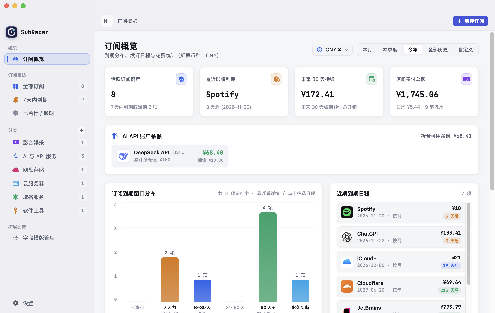
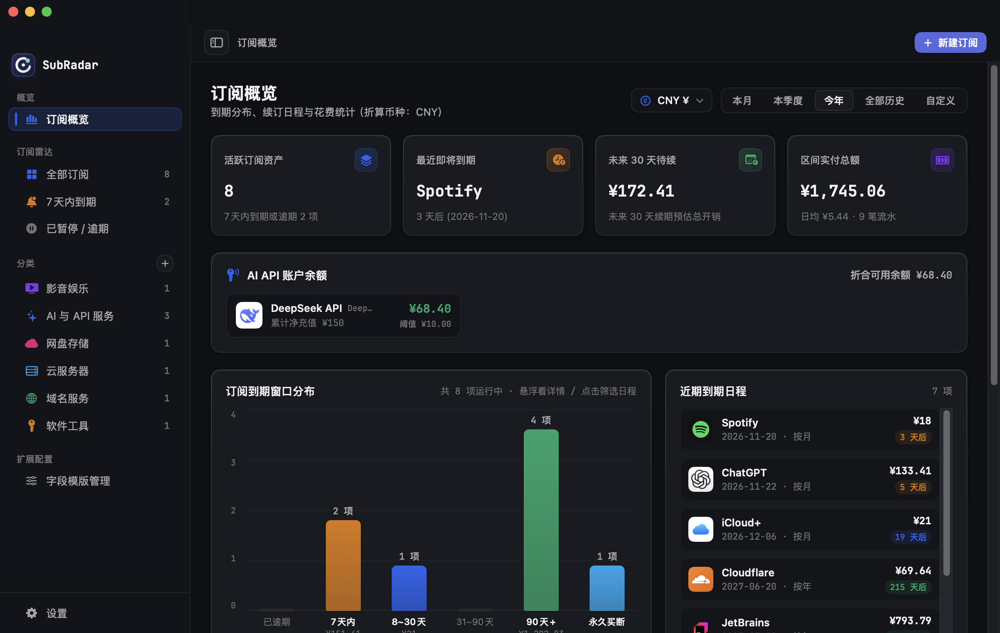
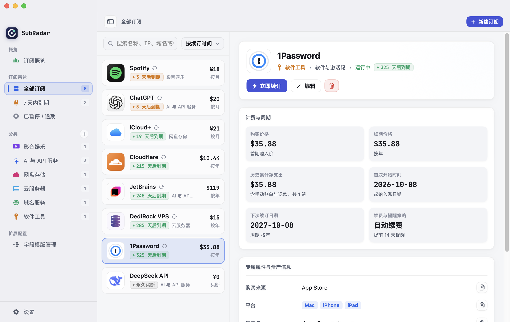
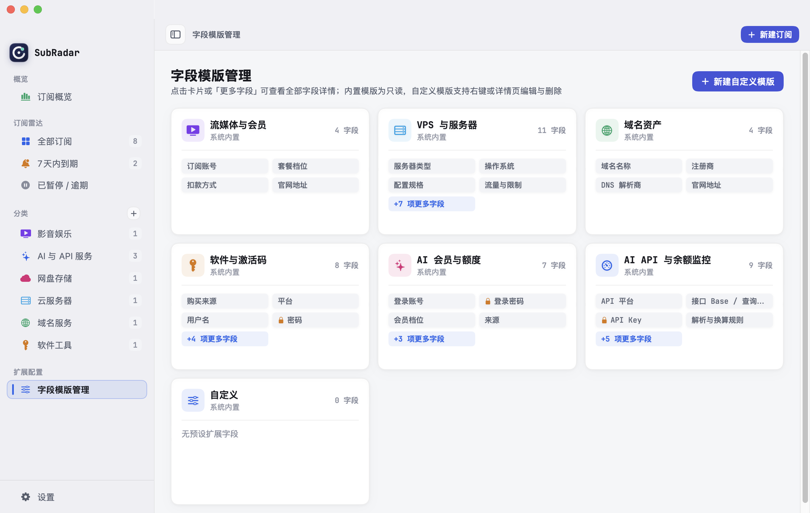

<div align="center">
  <h1>SubRadar</h1>
  <p><strong>A native macOS subscription, VPS, domain, software license & AI quota tracker built with SwiftUI and Swift 6.</strong></p>

  <p>
    <a href="https://github.com/Tianyang17/SubRadar/releases"></a>
    
    
    
    <a href="LICENSE"></a>
  </p>

  <p>
    <strong>English</strong> | <a href="README_zh-CN.md">简体中文</a>
  </p>

  <p>
    <a href="#-screenshots">Screenshots</a> •
    <a href="#-features">Features</a> •
    <a href="#-installation">Installation</a> •
    <a href="#-tech-stack--architecture">Architecture</a> •
    <a href="#-license">License</a>
  </p>
</div>

---

## 🖼️ Screenshots

<p align="center">
  
  
</p>

<p align="center">
  
  
</p>

---

## ✨ Features

* **📊 Multi-Currency Overview Dashboard (Default Home)**:
  * Interactive **Swift Charts** expiry radar, upcoming renewal schedule, monthly spending trend, and category breakdown.
  * Real-time conversion across 6 supported currencies (`CNY`, `USD`, `EUR`, `HKD`, `JPY`, `GBP`) with date-based historical exchange rates.
* **🧩 Orthogonal Categories & 7 Built-in Templates**:
  * Categories and field templates are completely decoupled (`Streaming`, `VPS & Server`, `Domain`, `Software & License`, `AI Membership`, `AI API Balance`, and blank `Custom`), plus user-defined categories and custom templates.
  * **VPS & Server**: One-click `ssh://` terminal launch, copyable full SSH commands, OS & spec composers.
  * **Software & License**: Multi-select supported platforms (`Mac`, `iPhone`, `iPad`, `Android`, `Windows`, `Linux`) and smart purchase source field rules.
  * **AI API Balance Monitor**: Built-in adapters (`DeepSeek`, `OpenRouter`, `SiliconFlow`, `New API`, `Sub2API`, or custom JSON endpoint) with live balance probing, low-balance alerts, and net top-up consumption calculation.
  * Drag-and-drop custom field reordering and direct keyboard date entry (`YYYY-MM-DD` / editable calendar month & year).
* **⚡ Quick Service Presets & External Import**:
  * Bundled 512×512 brand icons across 6 preset groups, App Store search import, and local `/Applications/*.app` icon & name extraction.
* **🔄 Flexible Billing Cycles & Manual Ledger**:
  * Supports one-time purchases, multi-period cycles (e.g., every 3 years / 4 months / 2 weeks), four renewal modes (`Automatic`, `Manual`, `Do Not Renew`, `Custom`), automatic multi-period historical backfill, and manual ledger entries (`Charge`, `Top-Up`, `Refund`).
* **🔔 Menu Bar Extra & Local Notifications**:
  * Quick menu bar status popover for upcoming renewals, configurable advance expiry reminders (`Same Day`, `1/3/7/14/30 days`), and silent background update staging.
* **🔒 Local-First Privacy**:
  * Pure local SQLite storage with zero telemetry or cloud accounts. Sensitive fields (passwords, license keys, API keys) are isolated via macOS Keychain / encrypted secret store, and local logs automatically redact credentials.

---

## 📥 Installation

### Option 1: One-Line `curl` Install / Upgrade (Recommended)

```bash
curl -fsSL https://raw.githubusercontent.com/Tianyang17/SubRadar/master/scripts/install.sh | bash
```

The installer automatically detects Apple Silicon (`arm64`) or Intel (`x86_64`), downloads the latest `.dmg` from GitHub Releases, verifies the SHA-256 checksum, and installs `SubRadar.app` into `/Applications`.

### Option 2: Direct `.dmg` Download

1. Download `SubRadar-v*-arm64.dmg` (Apple Silicon) or `SubRadar-v*-x86_64.dmg` (Intel) from the [Releases](https://github.com/Tianyang17/SubRadar/releases/latest) page.
2. Open the `.dmg` and drag `SubRadar.app` into `Applications`.

> **Gatekeeper Note (First Launch)**: Since open-source builds may not be notarized with an Apple Developer ID, right-click `SubRadar.app` → **Open** on first launch, or run:
> ```bash
> xattr -cr /Applications/SubRadar.app
> ```

### Build from Source (Optional)

Requires **macOS 14.0+** and **Xcode 16+ / Swift 6.0**:

```bash
git clone https://github.com/Tianyang17/SubRadar.git
cd SubRadar

# Build & run
swift run SubRadarApp

# Run full lint, Swift 6 strict concurrency check & unit tests
./scripts/check_quality.sh

# Package local .dmg installer
./scripts/package_dmg.sh arm64
```

---

## 💻 Tech Stack & Architecture

Built purely with native Apple frameworks and **zero third-party package dependencies**:

* **Language & Concurrency**: Swift 6.0 (`Sendable`, actor-isolated SQLite engine, `@MainActor` UI state)
* **UI & Visualization**: SwiftUI + Swift Charts + custom `DesignSystem` (Paper Light & Zinc Obsidian Dark themes)
* **Persistence**: Native `SQLite3` (`actor SQLiteDatabase`) + macOS Keychain / isolated secret storage

```text
Sources/
├── SubRadarCore/
│   ├── App/           # AppContainer dependency wiring (Production & In-Memory)
│   ├── Core/
│   │   ├── Database/  # Actor-isolated SQLite, migrations (V1–V21), repositories
│   │   ├── Engines/   # BillingEngine, NotificationEngine, Template & Preset catalogs
│   │   └── Services/  # ExchangeRate, APIBalanceProbe, AppUpdate, AppLog, Backup
│   ├── Models/        # Codable & Sendable domain models
│   └── ViewModels/    # @Observable Main, Editor, Analytics & Template ViewModels
└── SubRadarApp/
    ├── DesignSystem/  # Custom theme palettes, inputs, date picker, floating panels
    └── Views/         # Analytics, List, Detail, Editor, Templates, Settings, MenuBar
```

---

## 💬 Feedback & Feature Requests

You're warmly welcome to try out SubRadar! If you run into any bugs, have ideas for new features, or want specific presets or workflows supported, please feel free to open an [Issue](https://github.com/Tianyang17/SubRadar/issues) or submit a Pull Request. I actively monitor feedback and will review and follow up as soon as possible.

---

## 📄 License

Distributed under the **GNU General Public License v3.0**. See [LICENSE](LICENSE) for full details.
