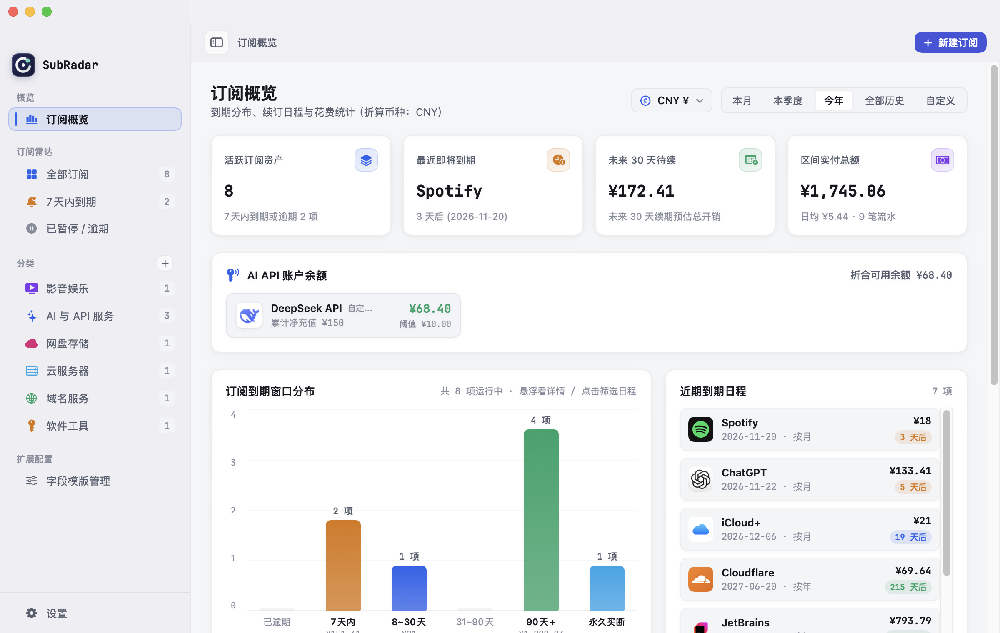
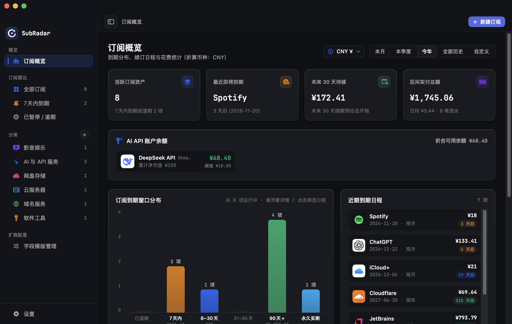
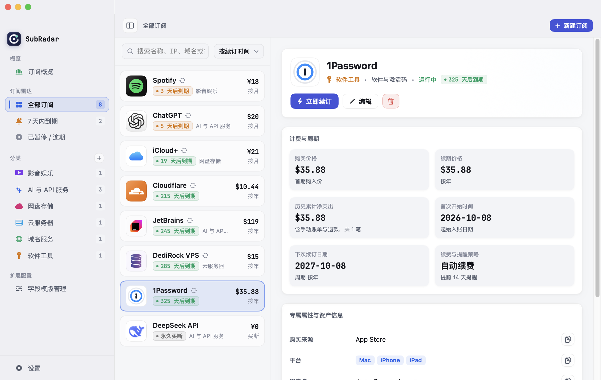
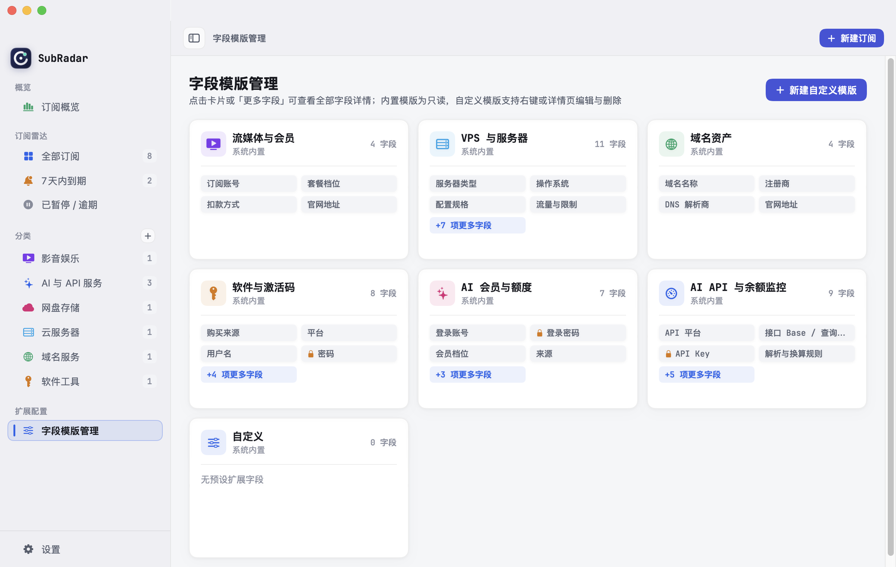

<div align="center">
  <h1>SubRadar</h1>
  <p><strong>基于 SwiftUI 与 Swift 6 构建的原生 macOS 订阅、VPS、域名、软件激活码与 AI 额度管理工具。</strong></p>

  <p>
    <a href="https://github.com/Tianyang17/SubRadar/releases"></a>
    
    
    
    <a href="LICENSE"></a>
  </p>

  <p>
    <a href="README.md">English</a> | <strong>简体中文</strong>
  </p>

  <p>
    <a href="#-界面截图">界面截图</a> •
    <a href="#-核心特性">核心特性</a> •
    <a href="#-安装方式">安装方式</a> •
    <a href="#-技术栈与架构">技术架构</a> •
    <a href="#-开源协议">开源协议</a>
  </p>
</div>

---

## 🖼️ 界面截图

<p align="center">
  
  
</p>

<p align="center">
  
  
</p>

---

## ✨ 核心特性

* **📊 多币种订阅概览大盘（默认首页）**：
  * 基于 **Swift Charts** 的到期窗口分布图、近期到期日程、月度支出趋势与分类占比。
  * 支持 `CNY / USD / EUR / HKD / JPY / GBP` 六种常用币种按账单日汇率实时折算。
* **🧩 业务分类与 7 大内置模版正交解耦**：
  * 分类决定统计归类，模版决定扩展字段蓝图。内置「流媒体与会员」「VPS 与服务器」「域名资产」「软件与激活码」「AI 会员与额度」「AI API 与余额监控」与纯空白「自定义」模版，支持自定义分类与自建模版。
  * **VPS 与服务器**：一键通过 `ssh://` 拉起终端连接、一键复制完整 SSH 命令、可视化规格/流量与系统版本组合器。
  * **软件与激活码**：支持多选适用平台（`Mac`、`iPhone`、`iPad`、`Android`、`Windows`、`Linux`），购买来源联动（如选中 `App Store` 自动精简密码/激活码/设备数）。
  * **AI API 余额监控**：内置 `DeepSeek`、`OpenRouter`、`SiliconFlow`、`New API`、`Sub2API` 及纯自定义 HTTP JSON 端点适配器，支持余额探测、低余额通知及 `累计净充值 − 当前余额` 实际消耗核算。
  * 支持订阅详情字段左侧把手拖拽上下排序，以及输入框直接键入 `YYYY-MM-DD` 与日历左上角手输年月快速跳转。
* **⚡ 常见服务预置库与外部导入**：
  * 内置 6 大分组高清 512×512 品牌图标库，支持 App Store 检索导入与 `/Applications/*.app` 本机应用图标与名称提取。
* **🔄 灵活计费周期与手工历史账本**：
  * 支持永久买断、自定义多期周期（如每 3 年 / 每 4 个月 / 每 2 周）、四态续订方式（自动续费 / 手动续费 / 不再续费 / 自定义），并支持跨期历史回算与手工追加历史流水（扣费 / 充值 / 退款）。
* **🔔 菜单栏常驻与本地提醒**：
  * 顶部菜单栏挂件快速查看临期项目；支持 `当天 / 提前 1 / 3 / 7 / 14 / 30 天` 本地通知提醒，以及后台定时静默检查更新。
* **🔒 本地优先与隐私安全**：
  * 纯本地 SQLite 存储，零云端账号、零遥测上报；密码、激活码、API Key 等敏感字段与普通业务表隔离存储，运行日志自动脱敏。

---

## 📥 安装方式

### 方式一：`curl` 一键安装 / 升级（推荐）

```bash
curl -fsSL https://raw.githubusercontent.com/Tianyang17/SubRadar/master/scripts/install.sh | bash
```

脚本会自动识别当前架构（Apple Silicon `arm64` 或 Intel `x86_64`），从 GitHub Releases 下载最新版本 `.dmg`、校验 SHA-256 哈希后安装到 `/Applications/SubRadar.app`。

### 方式二：直接下载 `.dmg` 安装包

1. 前往 [Releases 页面](https://github.com/Tianyang17/SubRadar/releases/latest) 下载对应架构的 `SubRadar-v*-arm64.dmg`（Apple Silicon）或 `SubRadar-v*-x86_64.dmg`（Intel）。
2. 双击打开 `.dmg` 并将 `SubRadar.app` 拖入 `Applications`（应用程序）文件夹。

> **Gatekeeper 首次打开提示**：由于开源个人构建暂未进行 Apple Developer ID 公证，首次打开如遇系统安全拦截，请右键点击 `SubRadar.app` → 选择 **打开**，或在终端执行：
> ```bash
> xattr -cr /Applications/SubRadar.app
> ```

### 如需从源码自行编译

环境要求：**macOS 14.0+**、**Xcode 16+ / Swift 6.0**：

```bash
git clone https://github.com/Tianyang17/SubRadar.git
cd SubRadar

# 编译并运行
swift run SubRadarApp

# 运行全量静态检查（<=300 行限制 / swift-format / Swift 6 严格并发）与单元测试
./scripts/check_quality.sh

# 打包本地 DMG 安装包
./scripts/package_dmg.sh arm64
```

---

## 💻 技术栈与架构

全程基于苹果系统原生框架开发，**零第三方 SPM 依赖**：

* **语言与并发模型**：Swift 6.0（严格并发安全、`Sendable`、Actor 隔离数据库访问、`@MainActor` UI 驱动）
* **界面与图表**：SwiftUI + Swift Charts + 全定制去原生化 `DesignSystem`（Paper Light 浅色 / Zinc Obsidian 暗黑双主题）
* **本地持久化**：原生 `SQLite3`（`actor SQLiteDatabase`）+ macOS Keychain / 隔离敏感凭据存储

```text
Sources/
├── SubRadarCore/
│   ├── App/           # AppContainer 依赖装配与生产启动入口
│   ├── Core/
│   │   ├── Database/  # Actor 隔离 SQLite、V1–V21 迁移与仓储实现
│   │   ├── Engines/   # 计费引擎、通知引擎、模版与预置服务目录
│   │   └── Services/  # 汇率换算、API 余额探针、应用更新、脱敏日志、备份导出
│   ├── Models/        # Codable & Sendable 核心领域模型
│   └── ViewModels/    # @Observable 主界面、编辑器、大盘分析与模版 ViewModel
└── SubRadarApp/
    ├── DesignSystem/  # 主题色板、定制输入控件、可直输日期选择器与悬浮面板
    └── Views/         # 订阅概览、列表详情、编辑器、模版管理、设置与菜单栏挂件
```

---

## 💬 欢迎试用与反馈

欢迎下载试用 SubRadar！如果你在使用过程中遇到任何问题、有新的功能想法，或者希望补充特定模版与使用场景，非常欢迎随时提交 [Issue](https://github.com/Tianyang17/SubRadar/issues) 或发起 Pull Request，我会尽快查看并跟进处理。

---

## 📄 开源协议

本项目基于 **GNU General Public License v3.0 (GPL-3.0)** 开源，详情请见 [LICENSE](LICENSE)。
